# Avatars

22 avatars. Use one by name: `Petfolio.summon({ character: 'finn' })`.
Browse them with live previews and copy buttons on the [Avatars page](https://andrew-velox.github.io/petfolio/avatars/).

## List

| Name | Author | Preview | Code name |
| --- | --- | --- | --- |
| Finn *(built in)* | kypo | 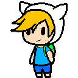 | `finn` |
| Ayaka | unknown | 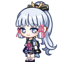 | `ayaka` |
| Gojo | unknown | 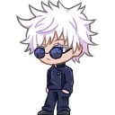 | `gojo` |
| Grim | unknown | 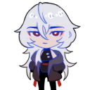 | `grim` |
| Homura | unknown | 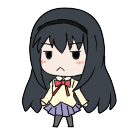 | `homura` |
| Jayfeather | unknown | 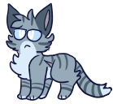 | `jayfeather` |
| Mami | unknown | 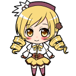 | `mami` |
| Mew | unknown | 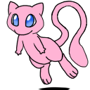 | `mew` |
| One Punch Man | unknown | 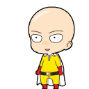 | `opm` |
| Pathfinder | unknown | 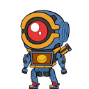 | `pathfinder` |
| Pebbles | unknown |  | `pebbles` |
| Pikachu | unknown | 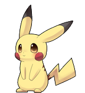 | `pikachu` |
| Po3 | unknown | 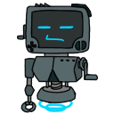 | `po3` |
| Psyche | unknown |  | `psyche` |
| Quilldren | unknown | 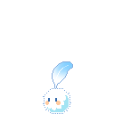 | `quilldren` |
| Red Fox | unknown | 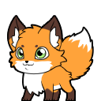 | `redfox` |
| Rick | unknown |  | `rick` |
| Saeyoung | kypo | 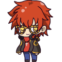 | `saeyoung` |
| Sakurai | unknown | 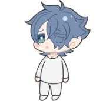 | `sakurai` |
| Shiro | unknown | 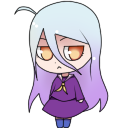 | `shiro` |
| SpongeBob | unknown | 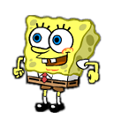 | `spongebob` |
| Wheatley | unknown | 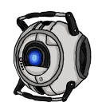 | `wheatley` |

## Add your own

Add a folder `avatars/<name>/` with `avatar.json` and `shime1.png … shime46.png`, then open a pull request.
This list is generated (`cd site && npm run avatars`); do not edit it by hand.
